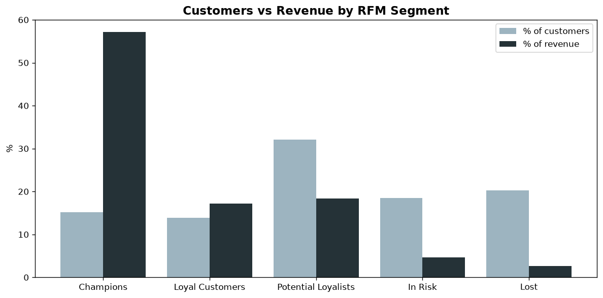
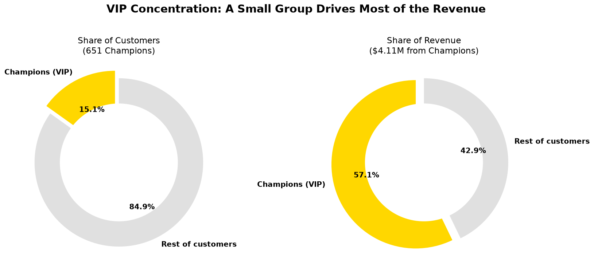
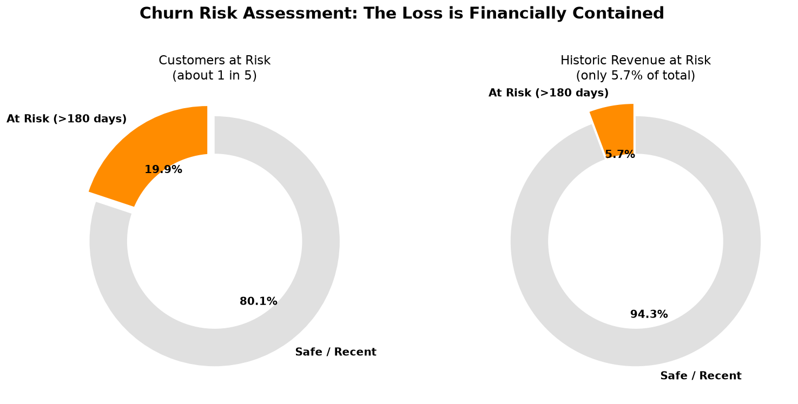

# E-Commerce Customer Segmentation and Retention Strategy (RFM)

> **Academic project.** Python analysis of a public e-commerce dataset.

Customer segmentation for a UK-based online retailer using **RFM analysis** (Recency, Frequency, Monetary). The goal: turn about 400,000 raw line items into customer segments that marketing can act on, and answer three business questions:

1. How concentrated is revenue in the best customers?
2. How many customers are at risk of churning, and how much revenue is at stake?
3. Do very frequent buyers place larger orders?

**Notebook:** [`notebooks/rfm_segmentation.ipynb`](notebooks/rfm_segmentation.ipynb) (executed end to end, outputs and charts included)

## Data

[UCI Online Retail](https://archive.ics.uci.edu/dataset/352/online+retail) (Daqing Chen, 2015, [doi:10.24432/C5BW33](https://doi.org/10.24432/C5BW33), CC BY 4.0): 541,909 transactions from 01 Dec 2010 to 09 Dec 2011. The raw file is not committed; see [`data/README.md`](data/README.md).

## Approach

| Phase | What it does |
| --- | --- |
| 1. Data engineering | Recover missing `CustomerID` from the same invoice, drop duplicates, parse dates, remove cancellations and non-positive prices **before** any RFM math, cap quantities at the 99th percentile, compute line revenue |
| 2. RFM matrix | Per customer: days since last purchase, number of distinct invoices, total revenue |
| 3. Scoring and segments | Quintile scores (1 to 5) per dimension, summed into an RFM score (3 to 15) and mapped to Champions, Loyal Customers, Potential Loyalists, In Risk, and Lost |
| 4. KPIs | VIP revenue concentration, 180-day churn exposure, average order value (AOV) of customers with more than 12 orders |
| 5. Storytelling | Donut and bar charts saved to [`images/`](images/) |

## Key results

After cleaning: 388,804 line items and 4,303 customers.

| Segment | Customers | % of customers | Revenue | % of revenue |
| --- | ---: | ---: | ---: | ---: |
| Champions | 651 | 15.1% | $4.11M | 57.1% |
| Loyal Customers | 599 | 13.9% | $1.23M | 17.1% |
| Potential Loyalists | 1,382 | 32.1% | $1.32M | 18.4% |
| In Risk | 797 | 18.5% | $0.33M | 4.6% |
| Lost | 874 | 20.3% | $0.19M | 2.7% |

- **VIP concentration:** 15.1% of customers (Champions) generate 57.1% of revenue.
- **Churn risk is contained:** 19.9% of customers (856) have not bought in more than 180 days, but they represent only 5.7% of revenue ($411,542).
- **Frequent buyers:** the 234 customers with more than 12 orders have a mean AOV of $459.25, 1.32x the $348.62 of everyone else.







## Recommendations

- Protect Champions with priority service and loyalty rewards; they are the smallest group with the largest revenue share.
- Use low-cost automated win-back campaigns for inactive customers, since their revenue weight is small.
- Push Potential Loyalists, the largest segment, toward a second and third purchase.
- Next step: a Tableau or Power BI dashboard on the exported segmentation file, plus cohort retention curves.

## How to run

```bash
python -m venv .venv && source .venv/bin/activate
pip install -r requirements.txt
python scripts/download_data.py      # optional, the notebook downloads the data if missing
jupyter notebook notebooks/rfm_segmentation.ipynb
```

The notebook writes `outputs/rfm_final_segmentation.csv` and `outputs/df_ready_to_analyze.csv` (ignored by git) and refreshes the charts in `images/`.

## Tools

Python, pandas, NumPy, Matplotlib, Jupyter.

## Author

Manuel Vazquez Lopez
